# Ditt0

<p>
  <picture>
    <source media="(prefers-color-scheme: dark)" srcset="assets/ditt0-dark.svg">
    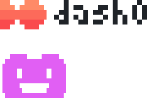
  </picture>
</p>

Read it *Ditt-zero* or *Ditt-oh*.

Components for terminal UIs: charts, stats, tables, forms and panes, in Dash0's colours. They work on their own with any data, and they can connect to Dash0.

## How it works

Ditt0 comes in two parts. They draw the same components, and you pick the one that fits where your UI runs.

| Part | Where it runs | How you use it |
| --- | --- | --- |
| **Claude Code plugin** | Inside Claude Code: the terminal, the desktop app, VS Code and mobile | Install it, then type a command such as `/book`, or ask Claude to show some data. A pane opens beside the chat |
| **[Go package](go/README.md)** | Any terminal program written in Go, with no Claude Code | Import it and call `ditt0.Timeseries` and the others. They return text your program prints |

Inside Claude Code there are three ways in, from least to most work:

1. **Ask Claude.** "Show this as a chart." Claude calls Ditt0's `ditt0_show` tool with the data, and a pane opens. Nothing to write.
2. **Describe a page as JSON** from a mod of your own (`$.ditt0.open`). Ditt0 draws it and keeps it live.
3. **Draw the components yourself** in JSX, when you need a layout the blocks don't give.

The data can be anything: numbers you have, a file, the answer of any tool. With a Dash0 MCP server connected, Ditt0 can also query Dash0 itself and refresh the page every 30 seconds.

The [dash0 CLI](https://github.com/dash0hq/dash0-cli) is a separate program. Its `dash0 k8s pods watch` page is drawn in Ditt0's style, and the Go package is how a Go program like it gets these components without copying them.

Colours are kept in one place, [tokens.js](components/foundations/tokens/tokens.js), and generated for the Go package and every other target, so the two parts can't drift.

## Install

```
git clone https://github.com/dash0hq/ditt0-cli-design-system.git
claude --plugin-dir ./ditt0-cli-design-system
```

That starts Claude Code with the plugin loaded. Type `/book` to see every component. For the Go package, see [Plain terminals (Go)](#plain-terminals-go).

The charts draw with block characters (`█ ▀ ▄ ▌`), so they need a terminal that draws those itself, filling each cell edge to edge: Orca, iTerm2, Ghostty, WezTerm or kitty. macOS Terminal takes them from the font and leaves a gap between rows, so squares and pie cells don't touch.

## Try it

| Command | What it opens |
| --- | --- |
| `/book` | The gallery: every component, its docs and live examples |
| `/book-tour` | A tour that plays itself |
| `/ditt0-close` | Closes every Ditt0 pane |

## Components

A few of the components, drawn here from their own code with sample data. `/book` shows all of them live, and [components/README.md](components/README.md) lists every one.

**[Timeseries](components/molecules/charts/timeseries/timeseries.md)**: Lines, with a panel each when the series would flatten one another.

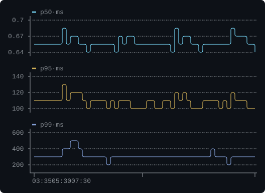

**[Timeseries, Dots](components/molecules/charts/timeseries/timeseries.md)**: The same chart as one thin line of braille dots.

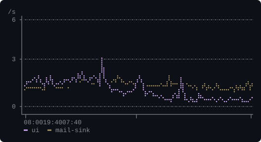

**[Stat](components/molecules/charts/stat/stat.md)**: One headline number, its change and its trend.

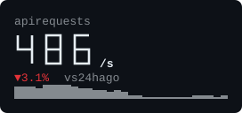

**[Stat, a row](components/molecules/charts/stat/stat.md)**: Several numbers side by side.

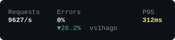

**[BarChart](components/molecules/charts/bar-chart/bar-chart.md)**: Ranked values.

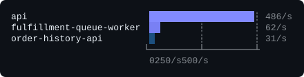

**[BarChart, stacked](components/molecules/charts/bar-chart/bar-chart.md)**: Parts of a total over time.

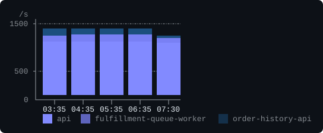

**[SquareChart](components/molecules/charts/square-chart/square-chart.md)**: Shares of one whole, a square a percent.

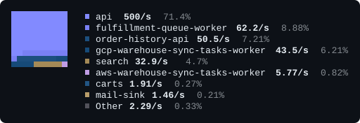

**[Heatmap](components/molecules/charts/heatmap/heatmap.md)**: How many spans took how long, over time.

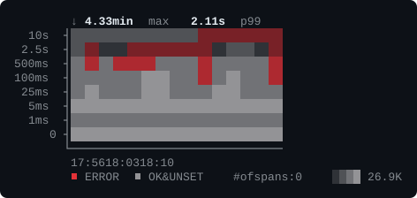

**[Gauge](components/molecules/charts/gauge/gauge.md)**: A value against its limit and thresholds.

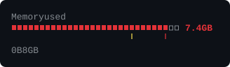

**[GanttChart](components/molecules/charts/gantt-chart/gantt-chart.md)**: Spans or tasks over time.

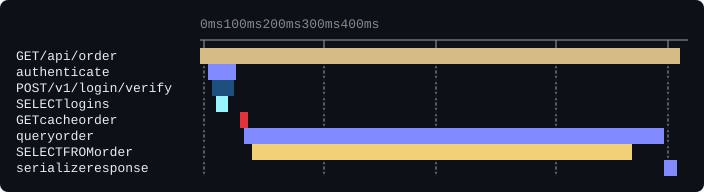

**[Progress](components/molecules/progress/progress.md)**: How full, coloured by status.

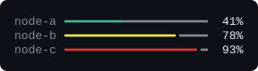

**[Banner](components/molecules/banner/banner.md)**: A message that needs attention.

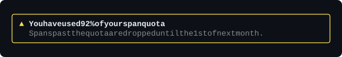

**[FlowDiagram](components/molecules/flow-diagram/flow-diagram.md)**: Mermaid, drawn as text.

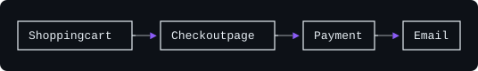

## Use with Dash0

Ditt0 draws live Dash0 data once a Dash0 MCP server is connected to Claude Code. `/mcp` lists the servers you have.

| How | What happens |
| --- | --- |
| `/dash0-dashboard [server]` | Opens Dash0's Services overview, live |
| `/dash0-tracing [server]` | Opens Dash0's Tracing explorer, live |
| `/ditt0-perses <file>` | Opens a Perses dashboard exported from Dash0 as a live pane |
| Ask Claude | "Show me how the api service is doing: requests, error rate, p95 and its slowest spans." Claude calls the `ditt0_show` tool and a live pane opens |

`[server]` is the name `/mcp` lists the Dash0 server under. Leave it out and Ditt0 uses the Dash0 server Claude called last.

A page asks Dash0 when it opens and again every 30 seconds. In a page of your own, give a block a `promql` and Ditt0 runs it against Dash0 for you, as in the example below. [connectors/README.md](connectors/README.md) explains how the Dash0 pages are built, and how to plug in another MCP server the same way.

Outside Claude Code, the [dash0 CLI](https://github.com/dash0hq/dash0-cli) draws its `dash0 k8s pods watch` page in this style. The [Go package](go/README.md) is there for other terminal programs that show Dash0 data.

## Use with your own data

Ditt0 needs no Dash0 account. Every component takes plain data: names, values and times.

| How | What happens |
| --- | --- |
| Ask Claude | "Chart the response times in results.csv." Claude reads the file, calls the `ditt0_show` tool with the numbers, and a pane opens |
| Ask Claude, after any tool | "Show that as a table and a bar chart." It works on what another MCP server or a command just answered |
| From your mod | `$.ditt0.open` with the data inline: see [Use it from your mod](#use-it-from-your-mod) |
| From a Go program | `ditt0.Timeseries` and the others in the [Go package](go/README.md), with your own numbers |

A block with inline data looks like this:

```js
{ type: 'timeseries', title: 'Response time', unit: 'ms',
  times: ['10:00', '10:05', '10:10'],
  series: [{ name: 'checkout', values: [120, 180, null] }] }
```

`null` is a missing sample: the line stops there, it never drops to zero. Bars take `bars: [{ label, value }]`, and a table takes `columns` and `rows`. [Spec Page](components/pages/spec-page/spec-page.md) lists every block.

To keep a page live from another source, [connectors/README.md](connectors/README.md) shows how to plug in another MCP server the way the Dash0 pages are built.

## Use it from your mod

Describe the page as JSON and let Ditt0 draw it and keep it live. Add `"dependencies": ["ditt0-cli-design-system"]` to your `plugin.json`, then:

```js
await $.ditt0.open({ id: 'api', title: 'API', blocks: [
    { type: 'stats', items: [{ label: 'Requests', unit: '/s', promql: RPS }] },
    { type: 'timeseries', title: 'Requests', unit: '/s', promql: RPS },
] })
```

`$.ditt0.update({ id, data })` pushes data of your own, and `$.ditt0.close({ id })` closes the pane. [examples/hello-ditt0](examples/hello-ditt0/hooks/register.js) is a whole mod built this way. The blocks are listed in [Spec Page](components/pages/spec-page/spec-page.md). A Perses dashboard opens the same way, `$.ditt0.open({ perses })`, or with `/ditt0-perses <file>`.

## Or draw the components yourself

Components are plain functions with JSX, returned from a `ui.render` hook:

```jsx
<ChartCard title="Requests">
    <Timeseries series={series} times={times} unit="/s" />
</ChartCard>
```

## Plain terminals (Go)

Ditt0 isn't only for Claude Code. [go/](go/README.md) is the same design system for terminal programs in Go, such as the [dash0 CLI](https://github.com/dash0hq/dash0-cli): Ditt0's colours, generated from [tokens.js](components/foundations/tokens/tokens.js), its `Timeseries`, `Stat`, `Sparkline`, `Button` and `ChartControls`, drawn as the JS components draw them (checked: Go must match the JS drawing of a fixed set of goldens byte for byte, so the two can't drift), and `Pane`'s keys: a page that scrolls, switches ranges on 1 to 4 and refreshes, the loop the k9s plugin built.

```go
import "github.com/dash0hq/ditt0-cli-design-system/go/ditt0"
```

## Learn more

- [components/README.md](components/README.md): how the library is laid out, and every component
- [skills/ditt0-ui/SKILL.md](skills/ditt0-ui/SKILL.md): which component to pick for your data, and the rules
- [connectors/README.md](connectors/README.md): plug in another app's data, from another mod, or through Claude

## Develop

```
claude plugin test .
claude plugin validate .
```

Read [CLAUDE.md](CLAUDE.md) first: every component change updates its doc page in the same commit.

## Credits

Ditt0 adapts code from these projects, under their licenses.

**[beautiful-mermaid](https://github.com/lukilabs/beautiful-mermaid) 1.1.3**: the Mermaid text renderer in `vendor/mermaid-text`, which FlowDiagram draws with.

```
MIT License

Copyright (c) 2026 Craft Docs

Permission is hereby granted, free of charge, to any person obtaining a copy
of this software and associated documentation files (the "Software"), to deal
in the Software without restriction, including without limitation the rights
to use, copy, modify, merge, publish, distribute, sublicense, and/or sell
copies of the Software, and to permit persons to whom the Software is
furnished to do so, subject to the following conditions:

The above copyright notice and this permission notice shall be included in all
copies or substantial portions of the Software.

THE SOFTWARE IS PROVIDED "AS IS", WITHOUT WARRANTY OF ANY KIND, EXPRESS OR
IMPLIED, INCLUDING BUT NOT LIMITED TO THE WARRANTIES OF MERCHANTABILITY,
FITNESS FOR A PARTICULAR PURPOSE AND NONINFRINGEMENT. IN NO EVENT SHALL THE
AUTHORS OR COPYRIGHT HOLDERS BE LIABLE FOR ANY CLAIM, DAMAGES OR OTHER
LIABILITY, WHETHER IN AN ACTION OF CONTRACT, TORT OR OTHERWISE, ARISING FROM,
OUT OF OR IN CONNECTION WITH THE SOFTWARE OR THE USE OR OTHER DEALINGS IN THE
SOFTWARE.
```

## License

[Apache-2.0](LICENSE).
